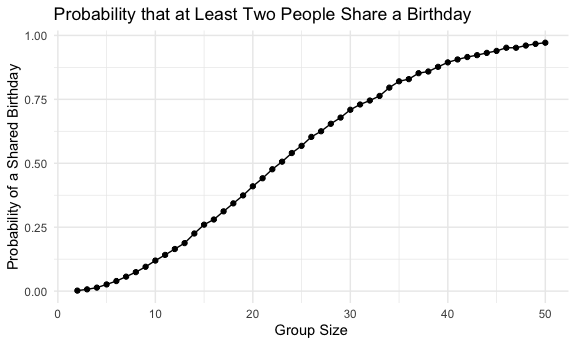

Data Science 1: HW5
================
2026-11-17

## Q1

``` r
birthday_sim = function(n) {

  if (!is.numeric(n) || n < 1) {
    stop("n_room should be a positive number")
  }

  birthdays = sample(1:365, size = n, replace = TRUE)

  repeated_bday = length(unique(birthdays)) < n

  repeated_bday
}
```

``` r
birthday_sim_df =
  expand_grid(
    group_size = 2:50,
    iter = 1:10000
  ) |>
  mutate(res = map_lgl(group_size, birthday_sim)) |>
  group_by(group_size) |>
  summarize(prob = mean(res))

birthday_sim_df
```

    ## # A tibble: 49 × 2
    ##    group_size   prob
    ##         <int>  <dbl>
    ##  1          2 0.002 
    ##  2          3 0.007 
    ##  3          4 0.0137
    ##  4          5 0.0262
    ##  5          6 0.0394
    ##  6          7 0.0566
    ##  7          8 0.0743
    ##  8          9 0.0952
    ##  9         10 0.120 
    ## 10         11 0.142 
    ## # ℹ 39 more rows

Plot

``` r
birthday_sim_df |>
  ggplot(aes(x = group_size, y = prob)) +
  geom_point() +
  geom_line() +
  labs(
    title = "Probability that at Least Two People Share a Birthday",
    x = "Group Size",
    y = "Probability of a Shared Birthday"
  )
```


Plotting the probability of sharing the same birthday as a function of
group size is a signmoidal curve. Generally the probability of sharing a
birthday increases as group size increases peaking at almost 1 or 100%
when group size is 50.
