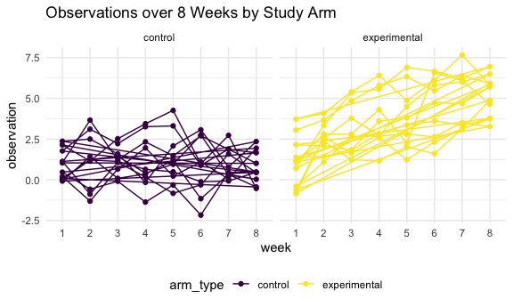
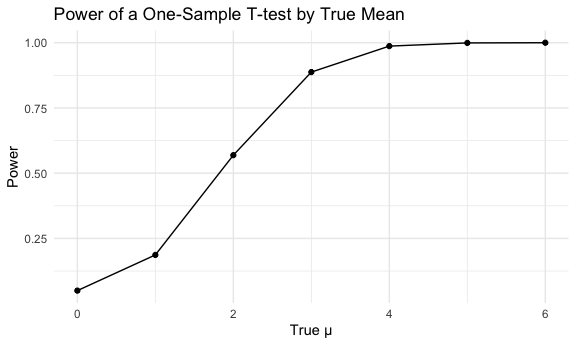
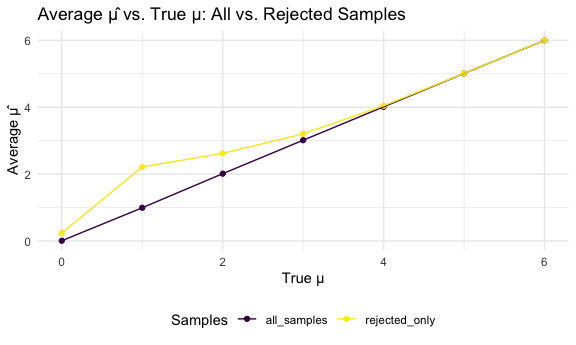

Data Science 1: HW5
================
2026-11-17

## Q1

``` r
birthday_sim = function(n) {

  if (!is.numeric(n) || n < 1) {
    stop("n_room should be a positive number")
  }

  birthdays = sample(1:365, size = n, replace = TRUE)

  repeated_bday = length(unique(birthdays)) < n

  repeated_bday
}
```

``` r
birthday_sim_df =
  expand_grid(
    group_size = 2:50,
    iter = 1:10000
  ) |>
  mutate(res = map_lgl(group_size, birthday_sim)) |>
  group_by(group_size) |>
  summarize(prob = mean(res))

birthday_sim_df
```

    ## # A tibble: 49 × 2
    ##    group_size   prob
    ##         <int>  <dbl>
    ##  1          2 0.0024
    ##  2          3 0.0085
    ##  3          4 0.0167
    ##  4          5 0.0267
    ##  5          6 0.0399
    ##  6          7 0.0521
    ##  7          8 0.0751
    ##  8          9 0.0925
    ##  9         10 0.116 
    ## 10         11 0.139 
    ## # ℹ 39 more rows

Plot

``` r
birthday_sim_df |>
  ggplot(aes(x = group_size, y = prob)) +
  geom_point() +
  geom_line() +
  labs(
    title = "Probability that at Least Two People Share a Birthday",
    x = "Group Size",
    y = "Probability of a Shared Birthday"
  )
```


Plotting the probability of sharing the same birthday as a function of
group size is a signmoidal curve. Generally the probability of sharing a
birthday increases as group size increases peaking at almost 1 or 100%
when group size is 50.

## Q2

``` r
full_df =
  tibble(
    files = list.files("data/"),
    path = str_c("data/", files)
  ) |>
  mutate(data = purrr::map(path, read_csv)) |> 
  unnest(data) |>
  mutate(files = str_remove(files, ".csv")) |>
  separate(files, into = c("arm_type", "subject_id"), sep = "_") |> 
  mutate(
    arm_type = case_match(
      arm_type,
      "con" ~ "control",
      "exp" ~ "experimental"
    )) |> 
  pivot_longer(
  starts_with("week_"),
  names_to = "week",
  names_prefix = "week_",
  values_to = "observation"
)
```

    ## Rows: 1 Columns: 8
    ## ── Column specification ────────────────────────────────────────────────────────
    ## Delimiter: ","
    ## dbl (8): week_1, week_2, week_3, week_4, week_5, week_6, week_7, week_8
    ## 
    ## ℹ Use `spec()` to retrieve the full column specification for this data.
    ## ℹ Specify the column types or set `show_col_types = FALSE` to quiet this message.
    ## Rows: 1 Columns: 8
    ## ── Column specification ────────────────────────────────────────────────────────
    ## Delimiter: ","
    ## dbl (8): week_1, week_2, week_3, week_4, week_5, week_6, week_7, week_8
    ## 
    ## ℹ Use `spec()` to retrieve the full column specification for this data.
    ## ℹ Specify the column types or set `show_col_types = FALSE` to quiet this message.
    ## Rows: 1 Columns: 8
    ## ── Column specification ────────────────────────────────────────────────────────
    ## Delimiter: ","
    ## dbl (8): week_1, week_2, week_3, week_4, week_5, week_6, week_7, week_8
    ## 
    ## ℹ Use `spec()` to retrieve the full column specification for this data.
    ## ℹ Specify the column types or set `show_col_types = FALSE` to quiet this message.
    ## Rows: 1 Columns: 8
    ## ── Column specification ────────────────────────────────────────────────────────
    ## Delimiter: ","
    ## dbl (8): week_1, week_2, week_3, week_4, week_5, week_6, week_7, week_8
    ## 
    ## ℹ Use `spec()` to retrieve the full column specification for this data.
    ## ℹ Specify the column types or set `show_col_types = FALSE` to quiet this message.
    ## Rows: 1 Columns: 8
    ## ── Column specification ────────────────────────────────────────────────────────
    ## Delimiter: ","
    ## dbl (8): week_1, week_2, week_3, week_4, week_5, week_6, week_7, week_8
    ## 
    ## ℹ Use `spec()` to retrieve the full column specification for this data.
    ## ℹ Specify the column types or set `show_col_types = FALSE` to quiet this message.
    ## Rows: 1 Columns: 8
    ## ── Column specification ────────────────────────────────────────────────────────
    ## Delimiter: ","
    ## dbl (8): week_1, week_2, week_3, week_4, week_5, week_6, week_7, week_8
    ## 
    ## ℹ Use `spec()` to retrieve the full column specification for this data.
    ## ℹ Specify the column types or set `show_col_types = FALSE` to quiet this message.
    ## Rows: 1 Columns: 8
    ## ── Column specification ────────────────────────────────────────────────────────
    ## Delimiter: ","
    ## dbl (8): week_1, week_2, week_3, week_4, week_5, week_6, week_7, week_8
    ## 
    ## ℹ Use `spec()` to retrieve the full column specification for this data.
    ## ℹ Specify the column types or set `show_col_types = FALSE` to quiet this message.
    ## Rows: 1 Columns: 8
    ## ── Column specification ────────────────────────────────────────────────────────
    ## Delimiter: ","
    ## dbl (8): week_1, week_2, week_3, week_4, week_5, week_6, week_7, week_8
    ## 
    ## ℹ Use `spec()` to retrieve the full column specification for this data.
    ## ℹ Specify the column types or set `show_col_types = FALSE` to quiet this message.
    ## Rows: 1 Columns: 8
    ## ── Column specification ────────────────────────────────────────────────────────
    ## Delimiter: ","
    ## dbl (8): week_1, week_2, week_3, week_4, week_5, week_6, week_7, week_8
    ## 
    ## ℹ Use `spec()` to retrieve the full column specification for this data.
    ## ℹ Specify the column types or set `show_col_types = FALSE` to quiet this message.
    ## Rows: 1 Columns: 8
    ## ── Column specification ────────────────────────────────────────────────────────
    ## Delimiter: ","
    ## dbl (8): week_1, week_2, week_3, week_4, week_5, week_6, week_7, week_8
    ## 
    ## ℹ Use `spec()` to retrieve the full column specification for this data.
    ## ℹ Specify the column types or set `show_col_types = FALSE` to quiet this message.
    ## Rows: 1 Columns: 8
    ## ── Column specification ────────────────────────────────────────────────────────
    ## Delimiter: ","
    ## dbl (8): week_1, week_2, week_3, week_4, week_5, week_6, week_7, week_8
    ## 
    ## ℹ Use `spec()` to retrieve the full column specification for this data.
    ## ℹ Specify the column types or set `show_col_types = FALSE` to quiet this message.
    ## Rows: 1 Columns: 8
    ## ── Column specification ────────────────────────────────────────────────────────
    ## Delimiter: ","
    ## dbl (8): week_1, week_2, week_3, week_4, week_5, week_6, week_7, week_8
    ## 
    ## ℹ Use `spec()` to retrieve the full column specification for this data.
    ## ℹ Specify the column types or set `show_col_types = FALSE` to quiet this message.
    ## Rows: 1 Columns: 8
    ## ── Column specification ────────────────────────────────────────────────────────
    ## Delimiter: ","
    ## dbl (8): week_1, week_2, week_3, week_4, week_5, week_6, week_7, week_8
    ## 
    ## ℹ Use `spec()` to retrieve the full column specification for this data.
    ## ℹ Specify the column types or set `show_col_types = FALSE` to quiet this message.
    ## Rows: 1 Columns: 8
    ## ── Column specification ────────────────────────────────────────────────────────
    ## Delimiter: ","
    ## dbl (8): week_1, week_2, week_3, week_4, week_5, week_6, week_7, week_8
    ## 
    ## ℹ Use `spec()` to retrieve the full column specification for this data.
    ## ℹ Specify the column types or set `show_col_types = FALSE` to quiet this message.
    ## Rows: 1 Columns: 8
    ## ── Column specification ────────────────────────────────────────────────────────
    ## Delimiter: ","
    ## dbl (8): week_1, week_2, week_3, week_4, week_5, week_6, week_7, week_8
    ## 
    ## ℹ Use `spec()` to retrieve the full column specification for this data.
    ## ℹ Specify the column types or set `show_col_types = FALSE` to quiet this message.
    ## Rows: 1 Columns: 8
    ## ── Column specification ────────────────────────────────────────────────────────
    ## Delimiter: ","
    ## dbl (8): week_1, week_2, week_3, week_4, week_5, week_6, week_7, week_8
    ## 
    ## ℹ Use `spec()` to retrieve the full column specification for this data.
    ## ℹ Specify the column types or set `show_col_types = FALSE` to quiet this message.
    ## Rows: 1 Columns: 8
    ## ── Column specification ────────────────────────────────────────────────────────
    ## Delimiter: ","
    ## dbl (8): week_1, week_2, week_3, week_4, week_5, week_6, week_7, week_8
    ## 
    ## ℹ Use `spec()` to retrieve the full column specification for this data.
    ## ℹ Specify the column types or set `show_col_types = FALSE` to quiet this message.
    ## Rows: 1 Columns: 8
    ## ── Column specification ────────────────────────────────────────────────────────
    ## Delimiter: ","
    ## dbl (8): week_1, week_2, week_3, week_4, week_5, week_6, week_7, week_8
    ## 
    ## ℹ Use `spec()` to retrieve the full column specification for this data.
    ## ℹ Specify the column types or set `show_col_types = FALSE` to quiet this message.
    ## Rows: 1 Columns: 8
    ## ── Column specification ────────────────────────────────────────────────────────
    ## Delimiter: ","
    ## dbl (8): week_1, week_2, week_3, week_4, week_5, week_6, week_7, week_8
    ## 
    ## ℹ Use `spec()` to retrieve the full column specification for this data.
    ## ℹ Specify the column types or set `show_col_types = FALSE` to quiet this message.
    ## Rows: 1 Columns: 8
    ## ── Column specification ────────────────────────────────────────────────────────
    ## Delimiter: ","
    ## dbl (8): week_1, week_2, week_3, week_4, week_5, week_6, week_7, week_8
    ## 
    ## ℹ Use `spec()` to retrieve the full column specification for this data.
    ## ℹ Specify the column types or set `show_col_types = FALSE` to quiet this message.

    ## Warning: There was 1 warning in `mutate()`.
    ## ℹ In argument: `arm_type = case_match(arm_type, "con" ~ "control", "exp" ~
    ##   "experimental")`.
    ## Caused by warning:
    ## ! `case_match()` was deprecated in dplyr 1.2.0.
    ## ℹ Please use `recode_values()` instead.

Plot

``` r
full_df |>  
  ggplot(aes(x = week, y = observation, group = arm_type, color = arm_type)) + 
  geom_point() + 
  geom_path() + 
  facet_grid(~arm_type) +
labs(title = "Observations over 8 Weeks by Study Arm")
```



Based on the two graphs observations in the control arm appear to stay
relatively constant over the 8 weeks and the range of data is between
-2.5 and 5.0. In comparison, observations in the experimental arm
increase over the 8 week period. The start of the data range at week 1
is -1.25 to 3.75 but by week 8 this range shifts upwards to 2.5 to 7.5.
This highlights how observational values increase over the 8 week period
in the experimental arm where as is in the control arm they stay
relatively consistent over time, which potentially suggests experimental
treatment the trend increase in observations.

``` r
sim = function(n = 30, mu = 0, sigma = 5) {
  
  sim_data = tibble(
    x = rnorm(n, mean = mu, sd = sigma)
  )
  
  sim_data |> 
    pull(x) |> 
    t.test(mu = 0) |> 
    broom::tidy() |> 
    select(mu_hat = estimate, p_value = p.value)
}
sim_results_df = 
  expand_grid(
    true_mu = 0:6,
    iter = 1:5000
  ) |> 
  mutate(output = map(true_mu, \(m) sim(mu = m))) |>  
  unnest(output)
```

Plot

``` r
sim_results_df |> 
  group_by(true_mu) |> 
  summarize(power = mean(p_value < 0.05)) |> 
  ggplot(aes(x = true_mu, y = power)) +
  geom_point() +
  geom_line() +
  labs(
    title = "Power of a One-Sample T-test by True Mean",
    x = "True μ",
    y = "Power"
  )
```



As effect size increases from 0 to 6, the power increases as a result.
The relationship between power and effect size follows a sigmoidal
curve. Power ranges from just above 0 and its maximum value is 1.

``` r
sim_results_df |> 
  group_by(true_mu) |> 
  summarize(
    all_samples = mean(mu_hat),
    rejected_only = mean(mu_hat[p_value < 0.05])
  ) |> 
  pivot_longer(
    -true_mu,
    names_to = "samples",
    values_to = "avg_mu_hat"
  ) |> 
  ggplot(aes(x = true_mu, y = avg_mu_hat, color = samples)) +
  geom_point() +
  geom_line() +
  labs(
    title = "Average μ̂ vs. True μ: All vs. Rejected Samples",
    x = "True μ",
    y = "Average μ̂",
    color = "Samples"
  )
```


For true mu values above 4, the sample average of mu hat across tests
for which the null is rejected is approximately equal to the true value
of mu but before true mu values of 5 this is not the case. In the graph,
this is where the yellow and purple lines meet. For smaller true mu
values (1–3), it is not equal: the average of mu hat for rejected tests
is higher than the true mu.

This is because when the true mu is smaller, more values fall below the
cutoff point of significance, so the test only rejects the samples that
happened to have a high estimate of mu This makes their average too
high. When the true mu is higher, fewer values fall below the cutoff
point of significance, so almost all samples are rejected (power is
close to 1), and the average of the rejected samples is about the same
as the average of all samples, which equals the true mu.
